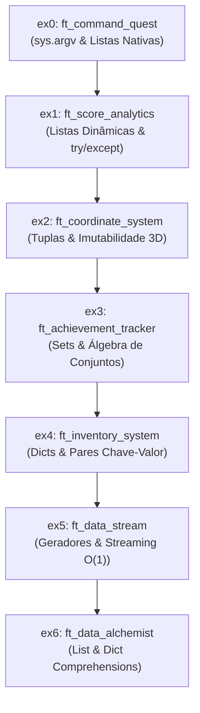

# Python Module 03 — Data Quest: Mastering Python Collections

> Guia definitivo de estudos e documentação técnica do **Python Module 03 (Versão 3.0)**.  
> Este documento explica minuciosamente o **porquê** de cada exercício existir, o que ele visa ensinar na transição da linguagem C para o Python, e a **lógica fluida e passo a passo do código**, servindo como roteiro de preparação para defesas (avaliações entre pares).

---

## 🧭 1. Filosofia e Contexto do Módulo

### O Lema: *"At scale, your data structure is your algorithm"*
Nos primórdios do Twitter, grande parte dos gargalos de desempenho em produção não se devia a servidores insuficientes, mas sim ao uso de **estruturas de dados sequenciais (como listas)** para verificar se algo já existia. A busca linear $O(n)$ multiplicada por milhões de requisições por segundo derrubava a infraestrutura. Ao trocar uma simples lista por uma estrutura baseada em tabela hash (como `set` ou `dict`), a complexidade caiu para tempo constante $O(1)$, resolvendo o problema instantaneamente.

O mesmo contraste é visto no universo dos jogos:
* Em **1980**, todo o estado do jogo *Pac-Man* (pontos, labirinto, estado dos fantasmas e score) precisava caber em **16 KB de RAM**.
* Hoje, jogos como *Fortnite* gerenciam simultaneamente mais de **10 milhões de jogadores conectados**, cada um disparando milhares de eventos por segundo.

O objetivo do **Module 03** é transformar o estudante em um verdadeiro engenheiro de dados, dominando as 4 principais coleções nativas do Python (`list`, `tuple`, `set`, `dict`), além de conceitos avançados de computação sob demanda com **geradores (`yield`)** e transformações idiomáticas com **comprehensions**.

### ⛓️ A Escada Didática (Respeito Estrito à Curva Pedagógica)
Uma característica essencial deste projeto é que **cada exercício introduz uma nova estrutura e não queima a largada das próximas**:
1. No **ex3**, usamos `list[tuple]` em vez de `dict`, pois dicionários só pertencem ao **ex4**.
2. No **ex5**, usamos loops tradicionais para popular listas em vez de *list comprehensions*, pois comprehensions são ensinadas no **ex6**.
3. Em todos os exercícios, mantemos `sys.argv`, tipagem estática rigorosa (`type hints`) e nenhum acesso a disco (`open()` proibido), trabalhando estritamente em memória.



---

## 🔍 2. Análise Detalhada dos Exercícios

---

### Exercise 0: Command Quest (`ex0/ft_command_quest.py`)

#### 🎯 Por que este exercício foi criado?
Todo programa de linha de comando (*CLI*) em qualquer sistema operacional precisa de uma porta de entrada para receber parâmetros do usuário. Este exercício é a ponte de transição direta entre o clássico `int main(int argc, char **argv)` de C e a abstração de alto nível do Python.

#### 💡 O que ele está tentando ensinar?
* **O módulo `sys`:** Como o interpretador Python expõe variáveis do sistema operacional através de `sys.argv`.
* **Natureza de `sys.argv`:** Compreender que `sys.argv` já nasce como uma lista nativa de strings (`list[str]`).
* **Diferença entre invocação e argumentos reais:** `sys.argv[0]` é sempre o nome ou caminho do script invocado, enquanto os argumentos reais passados pelo usuário começam no índice `1` (`sys.argv[1:]`).
* **Fatiamento (*slicing*):** Introdução à sintaxe de recorte `[1:]`, evitando manipulações manuais de ponteiros.

#### 🌊 Lógica Fluida do Código Passo a Passo
1. O script inicia obtendo a contagem total de itens em `sys.argv` com `len(sys.argv)` e armazenando em `total_args: int`.
2. O nome do script é capturado em `program_name: str = sys.argv[0]` e impresso na tela.
3. **Condição de guarda:** Se `total_args <= 1`, significa que o usuário não digitou nenhum argumento além de rodar o programa. O código imprime `"No arguments provided!"`.
4. **Fluxo com argumentos:** Caso contrário (`else`), calcula `arguments_received = total_args - 1`. Em seguida, fatia `sys.argv[1:]` atribuindo a `user_args: list[str]`.
5. Itera sobre cada elemento de `user_args`, imprimindo seu índice ordinal (`Argument 1: ...`, `Argument 2: ...`) com o incremento da variável `index`.
6. Finaliza exibindo a quantidade total (`Total arguments: <total_args>`).

#### 🗣️ Roteiro para a Defesa
> **Avaliador:** *"Por que você usou `user_args = sys.argv[1:]` em vez de percorrer com `sys.argv[i]`?"*  
> **Você:** *"O fatiamento (`[1:]`) é a forma idiomática do Python de ignorar o executável (`argv[0]`). Ele cria uma sublista contendo apenas os dados enviados pelo usuário, tornando a iteração direta (`for argument in user_args`) muito mais legível e segura contra erros de índice fora dos limites."*

---

### Exercise 1: Score Cruncher (`ex1/ft_score_analytics.py`)

#### 🎯 Por que este exercício foi criado?
Entradas do usuário são imprevisíveis e falhas. Em sistemas analíticos de jogos, pontuações chegam como textos que podem conter erros tipográficos ou caracteres ilegais. Este exercício ensina a **higienização de dados (Data Sanitization)** e agregações numéricas fundamentais.

#### 💡 O que ele está tentando ensinar?
* **Listas dinâmicas mutáveis:** Como listas em Python podem crescer dinamicamente em tempo de execução via `.append()`.
* **Tratamento gracioso de erros (`try/except`):** O mecanismo de exceções em Python substituindo os testes defensivos manuais com `isdigit()` ou códigos de retorno negativos do C.
* **Funções embutidas de agregação:** A velocidade e expressividade de `sum()`, `max()`, `min()` e `len()` em coleções numéricas.
* **Conceito de Score Range:** Medida estatística elementar de dispersão ($\text{Amplitude} = \text{Máximo} - \text{Mínimo}$).

#### 🌊 Lógica Fluida do Código Passo a Passo
1. **Ponto de entrada (`main`):** Valida se o usuário passou ao menos um argumento via `sys.argv`. Se `len(sys.argv) <= 1`, exibe a mensagem de ajuda (*Usage*) e aborta a execução sem quebrar.
2. **Processamento (`process_scores`):** Recebe os argumentos em formato string (`raw_args`).
   * Cria uma lista vazia `valid_scores: list[int] = []`.
   * Percorre cada string dentro de um bloco defensivo `try/except ValueError`.
   * Se a conversão `int(arg)` tiver sucesso, adiciona à lista com `.append(score)`.
   * Se disparar `ValueError`, captura o erro sem derrubar o programa e notifica o terminal: `"Invalid parameter: '<arg>'"` descartando-o.
3. **Segunda validação de guarda:** Se após o processamento `len(valid_scores) == 0` (todos eram letras ou inválidos), o programa exibe a mensagem de *Usage* e encerra.
4. **Exibição analítica (`display_analytics`):**
   * Calcula as métricas matemáticas: total de jogadores com `len()`, pontuação acumulada com `sum()`, média com `total_score / total_players` (gerando um `float`), maior valor com `max()`, menor valor com `min()` e amplitude `high_score - low_score`.
   * Exibe todas as informações formatadas conforme o padrão exigido pelo subject.

#### 🗣️ Roteiro para a Defesa
> **Avaliador:** *"Por que usar `try/except ValueError` em vez de verificar com `arg.isdigit()`?"*  
> **Você:** *"Porque `isdigit()` falha com números negativos (ex: `-10` contém o caractere `-`), além de não ser a filosofia padrão do Python. O Python segue o princípio EAFP (Easier to Ask for Forgiveness than Permission): tentamos a operação direta `int(arg)` e tratamos a exceção caso ela ocorra."*

---

### Exercise 2: Position Tracker (`ex2/ft_coordinate_system.py`)

#### 🎯 Por que este exercício foi criado?
Em ambientes de computação gráfica e física de jogos, coordenadas espaciais 3D $(x, y, z)$ são lidas continuamente. Elas precisam de garantia de **integridade estrutural**: uma coordenada não pode ter seu eixo $x$ alterado acidentalmente sem recriar o ponto. Para isso, o Python oferece a **Tupla (`tuple`)**.

#### 💡 O que ele está tentando ensinar?
* **Tuplas vs. Listas:** Tuplas são imutáveis (*read-only*), têm tamanho fixo e são mais leves em memória. Uma tupla funciona como uma `struct` constante em C.
* **Manipulação de Strings com `.split()` e `.strip()`:** A facilidade de quebrar textos delimitados por vírgula e eliminar espaços em branco laterais sem precisar recriar ponteiros manuais.
* **Laço de repetição com retry (`while True`):** Padrão de interface que insiste na solicitação até receber uma entrada correta.
* **Matemática Vetorial em 3D:** Aplicação da distância euclidiana tridimensional via teorema de Pitágoras estendido:
  $$d(P_1, P_2) = \sqrt{(x_2 - x_1)^2 + (y_2 - y_1)^2 + (z_2 - z_1)^2}$$
* **Formatação de precisão com `round()`:** Limitar a precisão numérica a 4 casas decimais.

#### 🌊 Lógica Fluida do Código Passo a Passo
1. **Entrada protegida (`get_player_pos`):**
   * Um loop infinito `while True` aguarda que o usuário digite coordenadas com `input()`.
   * Quebra a linha na vírgula usando `user_input.split(",")`.
   * **Checagem de sintaxe:** Se `len(parts) != 3`, não há exatamente 3 eixos. O código avisa `"Invalid syntax"` e reinicia o loop (`continue`).
   * Para cada eixo, limpa espaços acidentais com `.strip()` e tenta converter para `float`. Se o usuário digitar algo como `4,abc,5`, o Python gera um `ValueError`, e o código exibe exatamente o erro capturado: `"Error on parameter 'abc': could not convert string to float: 'abc'"`.
   * Havendo sucesso nas 3 coordenadas, empacota os 3 floats em uma tupla imutável `(coordinates[0], coordinates[1], coordinates[2])` e retorna.
2. **Execução principal (`main`):**
   * Coleta a primeira posição `pos1` chamando `get_player_pos()`.
   * Desempacota e exibe a tupla e seus eixos individuais (`X=...`, `Y=...`, `Z=...`).
   * Calcula a distância até a origem `(0, 0, 0)` usando `math.sqrt(pos1[0]**2 + pos1[1]**2 + pos1[2]**2)` e exibe com `round(..., 4)`.
   * Solicita a segunda posição `pos2`.
   * Aplica a fórmula euclidiana entre `pos1` e `pos2` e exibe o resultado arredondado.

#### 🗣️ Roteiro para a Defesa
> **Avaliador:** *"Por que retornar uma tupla e não uma lista para representar uma posição 3D?"*  
> **Você:** *"Porque uma coordenada é um valor atômico no espaço. Se usássemos uma lista, qualquer função externa poderia acidentalmente fazer `pos[0] = 999.0` ou dar `.append()`, corrompendo a física do jogo. Tuplas são imutáveis, garantem proteção contra alterações indesejadas e têm menor consumo de memória."*

---

### Exercise 3: Achievement Hunter (`ex3/ft_achievement_tracker.py`)

#### 🎯 Por que este exercício foi criado?
Em plataformas como Steam, PlayStation Network ou Xbox Live, jogos precisam calcular rapidamente medalhas desbloqueadas. Perguntas como: *"Qual conquista TODOS os jogadores pegaram?"* ou *"Qual medalha só o Player 1 tem?"* seriam extremamente custosas em tempo de processamento se usássemos listas ($O(n^2)$). Este exercício ensina a **Álgebra de Conjuntos (`set`)** para consultas instantâneas $O(1)$.

#### 💡 O que ele está tentando ensinar?
* **A estrutura `set`:** Coleção desordenada que não aceita elementos duplicados e indexa seus valores através de uma tabela hash interna.
* **Operações Fundamentais de Teoria dos Conjuntos:**
  * **União (`set.union()`):** Reúne todos os elementos distintos presentes em qualquer um dos conjuntos ($A \cup B$).
  * **Interseção (`set.intersection()`):** Filtra apenas os elementos compartilhados por todos os conjuntos ao mesmo tempo ($A \cap B$).
  * **Diferença (`set.difference()`):** Extrai o que pertence a um conjunto e não está no outro ($A \setminus B$).
* **Respeito Pedagógico Estrito:** Note que **não utilizamos dicionários** neste exercício! Criamos `players: list[tuple[str, set[str]]]` para mapear o nome do jogador ao seu conjunto, pois a estrutura `dict` só é formalmente autorizada e introduzida no exercício seguinte (ex4).
* **Por que `set()` e não `{}`?** Compreender por que o Python exibe um conjunto vazio como `set()`.

#### 🌊 Lógica Fluida do Código Passo a Passo
1. **Catálogo de Conquistas (`ACHIEVEMENTS_POOL`):** Uma lista de 14 conquistas do jogo.
2. **Gerador Aleatório (`gen_player_achievements`):**
   * Sorteia um número de conquistas entre 5 e 9 com `random.randint()`.
   * Usa `random.sample()` para selecionar medalhas aleatórias e sem repetição do catálogo.
   * Converte a seleção em um conjunto através de `set(selected)`.
3. **Mapeamento dos 4 Jogadores:**
   * Cria uma lista de tuplas contendo `("Alice", set), ("Bob", set), ("Charlie", set), ("Dylan", set)`.
   * Exibe as conquistas sorteadas para cada jogador.
4. **Extração e Operações Globais:**
   * Reúne todos os conjuntos em `player_sets: list[set[str]]`.
   * **Todas distintas (União):** `set.union(*player_sets)` reúne o total de conquistas conquistadas por pelo menos um jogador.
   * **Comuns a todos (Interseção):** `set.intersection(*player_sets)` descobre quais medalhas todos os 4 possuem simultaneamente.
5. **Conquistas Exclusivas de Cada Jogador:**
   * Para cada jogador, coleta os sets dos outros 3 jogadores em `other_sets`.
   * Faz a união dos outros (`other_union = set.union(*other_sets)`).
   * A diferença `set.difference(current_set, other_union)` isola o que só aquele jogador possui.
6. **Conquistas Faltantes para 100%:**
   * Converte todo o catálogo do jogo em um conjunto `all_possible = set(ACHIEVEMENTS_POOL)`.
   * A diferença `set.difference(all_possible, current_set)` revela o que o jogador ainda precisa conquistar.

#### 🗣️ Roteiro para a Defesa
> **Avaliador:** *"Por que você usou `list[tuple[str, set[str]]]` para os jogadores em vez de um dicionário `dict`?"*  
> **Você:** *"Porque de acordo com a progressão pedagógica do subject, o dicionário só é introduzido e autorizado no Exercício 4. Usar tuplas dentro de listas demonstra que respeitamos a ordem de aprendizado das estruturas de dados."*
>
> **Avaliador:** *"Por que um conjunto vazio é impresso como `set()` e não `{}`?"*  
> **Você:** *"Porque a sintaxe `{}` já era historicamente reservada pelo Python para declarar um dicionário vazio. Para evitar conflito gramatical, o interpretador imprime `set()` para conjuntos vazios."*

---

### Exercise 4: Inventory Master (`ex4/ft_inventory_system.py`)

#### 🎯 Por que este exercício foi criado?
Em qualquer RPG ou sistema de e-commerce, estoques exigem relacionamento direto entre um **identificador único (chave)** e uma **quantidade associada (valor)**. O `dict` é a estrutura de dados mais importante do Python, sendo a base interna da própria linguagem (namespaces, classes e módulos são dicionários internamente).

#### 💡 O que ele está tentando ensinar?
* **A estrutura `dict`:** Tabela hash com mapeamento de chave-valor.
* **Validação de Sintaxe em CLI:** Garantir o formato estrito `item:quantidade`.
* **Detecção de redundância:** Chaves em dicionários são únicas; tentar inserir uma chave duplicada sobrescreve o valor anterior, por isso o código detecta e avisa antes.
* **Métodos Nativos de Dicionário:**
  * `dict.keys()`: Retorna as chaves (itens).
  * `dict.values()`: Retorna os valores (quantidades).
  * `dict.items()`: Itera simultaneamente sobre `(chave, valor)`.
  * `dict.update()`: Insere ou mescla novos pares chave-valor.
* **Preservação de Ordem de Inserção (Python 3.7+):** Como resolver empates na busca do item mais/menos abundante escolhendo o primeiro que apareceu na linha de comando.

#### 🌊 Lógica Fluida do Código Passo a Passo
1. **Análise de Argumentos (`parse_inventory`):**
   * Inicializa `inventory: dict[str, int] = {}`.
   * Percorre cada argumento e divide no caractere dois-pontos com `argument.split(":")`.
   * **Validação de formato:** Se `len(parts) != 2`, a sintaxe está incorreta (ex: `"hello"`), exibe `"Error - invalid parameter '<argument>'"` e pula para o próximo.
   * **Validação de duplicatas:** Se `item_name in inventory`, avisa `"Redundant item '<item_name>' - discarding"`.
   * **Conversão de quantidade:** Tenta converter a quantidade com `int(quantity_str)`. Se falhar (ex: `"key:value"`), captura o `ValueError` nativo e exibe `"Quantity error for 'key': invalid literal for int()..."`.
   * Se tudo estiver correto, armazena no dicionário: `inventory[item_name] = quantity`.
2. **Cálculos Analíticos (`display_analytics`):**
   * Imprime o dicionário completo.
   * Converte `dict.keys()` em lista via `list(inventory.keys())` para listar os nomes dos itens.
   * Soma todos os valores com `sum(inventory.values())` e conta os itens com `len(inventory)`.
   * Itera com `for item_name, quantity in inventory.items()` para calcular a porcentagem de cada item em relação ao total: `round((quantity / total_quantity) * 100, 1)`.
   * **Resolução do empate:** Inicializa `most_item` e `least_item` com o primeiro item inserido. Ao iterar, usa comparações estritas `>` e `<`. Se um item posterior tiver quantidade idêntica, a condição `>` ou `<` resulta em `False`, mantendo a primeira ocorrência da CLI como manda o subject!
   * Usa `inventory.update({"magic_item": 1})` e exibe o dicionário atualizado.

#### 🗣️ Roteiro para a Defesa
> **Avaliador:** *"Como você garantiu que em caso de empate de quantidade, o primeiro item passado no terminal seja o escolhido?"*  
> **Você:** *"Desde o Python 3.7, os dicionários mantêm oficialmente a ordem de inserção dos elementos. Como inserimos na mesma ordem em que os argumentos foram lidos do terminal, ao usar comparações estritas (`if quantity > most_qty`), se um item novo tiver quantidade igual, ele não substitui o anterior, preservando o primeiro automaticamente."*

---

### Exercise 5: Stream Wizard (`ex5/ft_data_stream.py`)

#### 🎯 Por que este exercício foi criado?
Se um jogo com 10 milhões de jogadores gerar 100 eventos por segundo, carregar tudo isso em uma lista tradicional causará estouro imediato de memória RAM (*Out of Memory / OOM crash*). Este exercício ensina o paradigma de **Streaming e Avaliação Tardia (*Lazy Evaluation*)** usando **Geradores (`yield`)**.

#### 💡 O que ele está tentando ensinar?
* **A palavra-chave `yield`:** Transforma uma função comum em um gerador iterável. Ao encontrar um `yield`, a função retorna o valor atual e congela seu estado local até ser chamada novamente.
* **A função embutida `next()`:** Acorda manualmente o gerador para produzir seu próximo valor.
* **Pegada de memória $O(1)$:** Um gerador infinito de eventos consome a mesma quantidade minúscula de bytes na memória que um gerador de apenas um evento.
* **Tipagem formal de Geradores:** `typing.Generator[YieldType, SendType, ReturnType]`.
* **Consumo reativo em `for .. in ..`:** Como utilizar uma função geradora diretamente na sintaxe do laço de repetição.
* **Respeito Pedagógico Estrito:** Construímos a lista de 10 eventos usando um loop tradicional `for _ in range(10): events_list.append(next(event_stream))` em vez de *list comprehension*, pois as comprehensions são o tema exclusivo do exercício final.

#### 🌊 Lógica Fluida do Código Passo a Passo
1. **Gerador Infinito (`gen_event`):**
   * Contém um loop infinito `while True`.
   * Sorteia aleatoriamente um jogador da lista `PLAYERS` e uma ação de `ACTIONS`.
   * Executa `yield (player, action)` produzindo uma tupla sob demanda e pausando a função.
2. **Consumo em Lote com `next()`:**
   * Instancia o gerador: `event_stream = gen_event()`.
   * Em um loop de `range(1000)`, consome 1.000 eventos invocando `player, action = next(event_stream)`.
   * Exibe: `"Event 0: Player bob did action run"`, até o evento 999.
3. **Construção de Buffer:**
   * Cria uma lista vazia `events_list = []` e a preenche com 10 chamadas a `next(event_stream)`.
   * Exibe a lista original criada com 10 tuplas.
4. **Gerador Consumidor Destrutivo (`consume_event`):**
   * Recebe a lista por referência.
   * Enquanto `len(events) > 0`, sorteia um índice aleatório com `random.randrange(len(events))` e o remove com `.pop(index)`.
   * Produz o evento removido com `yield event`.
5. **Consumo no Loop `for`:**
   * O loop `for event in consume_event(events_list):` consome o gerador.
   * A cada iteração, exibe o evento sorteado e o estado atualizado da lista remanescente, que vai diminuindo até ficar vazia `[]`.

#### 🗣️ Roteiro para a Defesa
> **Avaliador:** *"Qual é a diferença entre uma função com `return` e uma função com `yield`?"*  
> **Você:** *"O `return` finaliza a execução da função, destrói seu escopo local e entrega um resultado final. O `yield` transforma a função em um objeto gerador: ele devolve um valor intermediário, congela o estado das variáveis e pausa a execução exatamente naquela linha até que o próximo valor seja solicitado via `next()` ou por um loop `for`."*

---

### Exercise 6: Data Alchemist (`ex6/ft_data_alchemist.py`)

#### 🎯 Por que este exercício foi criado?
Transformar e filtrar coleções de dados é a rotina diária de qualquer cientista ou engenheiro de dados. Fazer isso criando listas vazias e chamando `.append()` em loops tradicionais é prolixo e ineficiente. Este exercício ensina a sintaxe mais elegante e otimizada do Python: **Comprehensions**.

#### 💡 O que ele está tentando ensinar?
* **List Comprehensions:** Sintaxe concisa para mapear e filtrar elementos de listas em uma única linha.
* **Dict Comprehensions:** Criação e filtragem rápida de dicionários sem necessidade de loops manuais.
* **Métodos de String (`capitalize()` vs. `istitle()`):**
  * `capitalize()`: Transforma a primeira letra em maiúscula e as demais em minúsculas.
  * `istitle()`: Verifica se a palavra já está no formato capitalizado (Titlecase).
* **Desempenho em Baixo Nível:** Comprehensions rodam em nível de bytecode otimizado na linguagem C do interpretador CPython, sendo mais rápidas que laços manuais com `.append()`.
* **Regra de Linha Única:** Obedecer à restrição do subject mantendo cada comprehension em uma única linha legível dentro do limite de 79 caracteres do PEP 8.

#### 🌊 Lógica Fluida do Código Passo a Passo
1. **Lista Base:** Uma lista de 9 nomes de jogadores com capitalizações inconsistentes:
   `["Alice", "bob", "Charlie", "dylan", "Emma", "Gregory", "john", "kevin", "Liam"]`.
2. **List Comprehension 1 (Transformação / Mapeamento):**
   ```python
   all_capitalized = [name.capitalize() for name in players]
   ```
   * Itera sobre cada nome e aplica `.capitalize()`, gerando uma nova lista padronizada com todos os nomes começando com maiúscula.
3. **List Comprehension 2 (Filtragem Condicional):**
   ```python
   only_capitalized = [name for name in players if name.istitle()]
   ```
   * Itera sobre a lista inicial, mas inclui no resultado apenas os elementos onde a condição `if name.istitle()` for verdadeira (`Alice`, `Charlie`, `Emma`, etc.).
4. **Dict Comprehension 1 (Geração de Dicionário com Dados Aleatórios):**
   ```python
   score_dict = {name: random.randint(1, 1000) for name in all_capitalized}
   ```
   * Cria pares `chave: valor` onde a chave é o nome capitalizado e o valor é um número aleatório de 1 a 1000 sorteado por `random.randint()`.
5. **Cálculo da Média Geral:**
   * Soma todos os scores do dicionário com `sum(score_dict.values())`, divide pelo total de jogadores `len(score_dict)` e arredonda para 2 casas decimais.
6. **Dict Comprehension 2 (Filtragem em Dicionário):**
   ```python
   high_scores = {name: score for name, score in score_dict.items() if score > average_score}
   ```
   * Percorre os pares com `.items()`, selecionando apenas os jogadores cuja pontuação for estritamente superior à média calculada.

#### 🗣️ Roteiro para a Defesa
> **Avaliador:** *"Qual a vantagem de usar comprehension em vez de um loop `for` com `.append()`?"*  
> **Você:** *"Além de deixar o código conciso, limpo e declarativo, as comprehensions são executadas no CPython por uma instrução de bytecode otimizada em C (`LIST_APPEND` / `MAP_ADD`), eliminando a sobrecarga de busca de atributo que ocorre ao chamar o método `.append()` do Python a cada iteração."*

---

## 📊 3. Tabela Comparativa de Estruturas de Dados

Esta tabela resume os critérios técnicos que você deve ter na ponta da língua durante as avaliações:

| Estrutura | Sintaxe | Mutável? | Ordenada? | Duplicatas? | Acesso | Complexidade de Busca | Caso Ideal de Uso |
| :--- | :---: | :---: | :---: | :---: | :---: | :---: | :--- |
| **Lista (`list`)** | `[1, 2]` | **Sim** | **Sim** | **Sim** | Por índice `[0]` | $O(n)$ Linear | Coleções sequenciais dinâmicas onde a ordem importa. |
| **Tupla (`tuple`)** | `(1, 2)` | **Não** | **Sim** | **Sim** | Por índice `[0]` | $O(n)$ Linear | Dados estáticos, coordenadas 3D e structs imutáveis. |
| **Conjunto (`set`)** | `{1, 2}` | **Sim** | **Não** | **Não** | Não indexado | $O(1)$ Hash | Deduplicação automática, união, interseção e testes `in`. |
| **Dicionário (`dict`)** | `{"a": 1}` | **Sim** | **Sim** (3.7+) | Chaves não | Pela chave `["a"]` | $O(1)$ Hash | Mapeamento chave-valor, cadastros, inventários e índices. |
| **Gerador (`yield`)** | `(x for x in ...)` | N/A | Sequencial | Permite | Com `next()` | $O(1)$ Memória | Processamento sob demanda de grandes volumes de dados. |

---

## 🧪 4. Guia Rápido de Testes no Terminal

Execute os comandos abaixo a partir da raiz do repositório para testar todas as funcionalidades:

```bash
# Exercise 0: Argumentos de Linha de Comando
python3 ex0/ft_command_quest.py
python3 ex0/ft_command_quest.py hello world 42
python3 ex0/ft_command_quest.py "Data Quest"

# Exercise 1: Tratamento de Erros e Estatísticas de Pontuação
python3 ex1/ft_score_analytics.py 1500 2300 1800 2100 1950
python3 ex1/ft_score_analytics.py
python3 ex1/ft_score_analytics.py ab ac
python3 ex1/ft_score_analytics.py 100 invalid 200

# Exercise 2: Coordenadas 3D e Distâncias Euclidianas
python3 ex2/ft_coordinate_system.py
# (Insira: hello world -> erro)
# (Insira: 1.0, 2.5, 3.0 -> válido)
# (Insira: 4,abc,5 -> erro)
# (Insira: 4,5,6 -> válido)

# Exercise 3: Rastreador de Conquistas com Teoria dos Conjuntos
python3 ex3/ft_achievement_tracker.py

# Exercise 4: Gerenciamento de Inventário com Dicionários
python3 ex4/ft_inventory_system.py sword:1 potion:5 shield:2 armor:3 helmet:1 sword:2 hello key:value

# Exercise 5: Processador de Fluxo com Geradores
python3 ex5/ft_data_stream.py

# Exercise 6: Transformação de Dados com Comprehensions
python3 ex6/ft_data_alchemist.py
```
