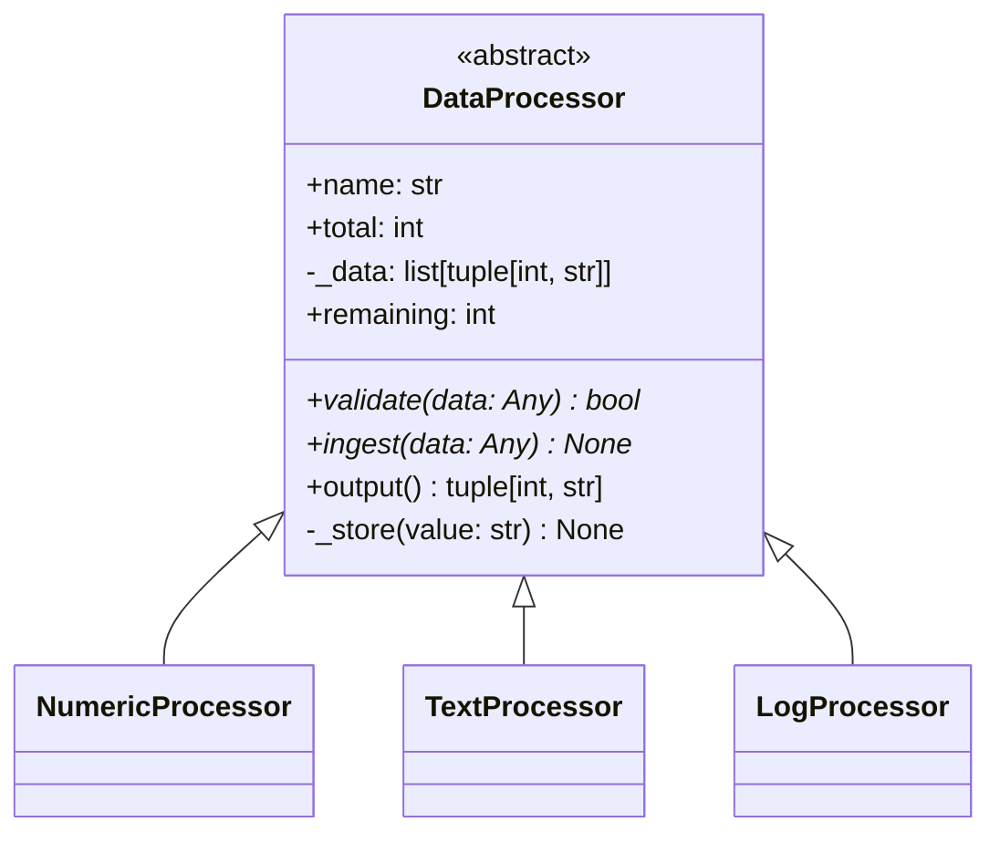
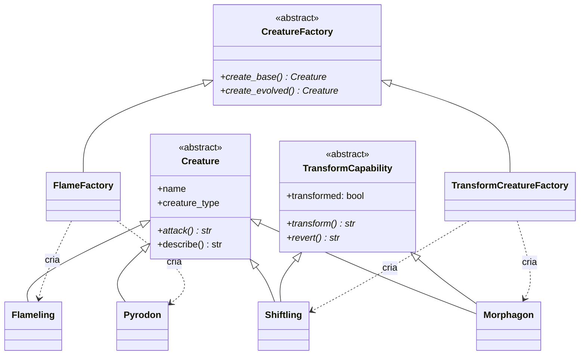
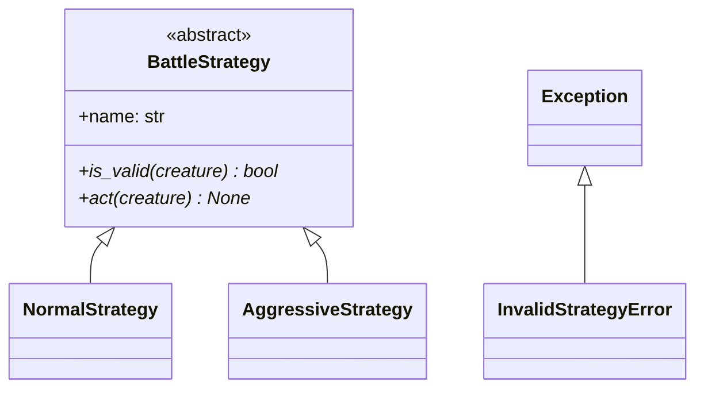

# Code Nexus — Explicação do código (Python Module 06-bis)

Este documento explica **a lógica**, **as importações** e **as decisões** de cada exercício.
A ideia geral foi manter o código o mais **simples e direto** possível: poucas classes além
das pedidas, nada de truques, e cada decisão justificável na defesa.

> [!NOTE]
> Verificação feita: as saídas são **idênticas** às do PDF, com uma exceção no ex0: lá foram
> acrescentadas 2 linhas que validam um dado **válido** no Text e no Log, porque o subject pede
> "valid and invalid data for each class". `flake8 .` não mostra nada e `mypy .` mostra
> **apenas** o aviso proposital do ex0 (linha `numeric.ingest("foo")`).

---

## Visão geral dos arquivos

```
.
|-- data_processor.py     # ex0 - hierarquia ABC de processors
|-- data_stream.py        # ex1 - ex0 + DataStream (polimorfismo)
|-- data_pipeline.py      # ex2 - ex1 + ExportPlugin (Protocol) + CSV/JSON
|-- ex3/
|   |-- __init__.py       # expõe SÓ as fábricas
|   |-- creature.py       # Creature (ABC)
|   |-- capability.py     # TransformCapability (ABC, NÃO é Creature)
|   |-- creatures.py      # Flameling, Pyrodon, Shiftling, Morphagon
|   `-- factories.py      # CreatureFactory (ABC) + 2 fábricas concretas
|-- battle.py             # teste das fábricas
|-- capacitor.py          # teste da capability de transformação
|-- ex4/
|   |-- __init__.py       # expõe as estratégias e a exceção
|   `-- strategies.py     # BattleStrategy (ABC) + Normal + Aggressive
`-- tournament.py         # torneio usando fábricas + estratégias
```

## Importações usadas (e por quê)

| Import | Onde | Para quê |
|---|---|---|
| `from abc import ABC, abstractmethod` | ex0–ex2, ex3, ex4 | Criar classes abstratas: não podem ser instanciadas e obrigam as subclasses a implementar os métodos marcados. |
| `from typing import Any` | ex0–ex2 | Tipar dados de tipo desconhecido (`validate(data: Any)`, `stream: list[Any]`). |
| `from typing import Protocol` | ex2 | Definir `ExportPlugin` por **tipagem estrutural** (duck typing). |
| `from ex3 import ...` / `from ex3.xxx import ...` | battle, capacitor, ex4, tournament | Importar entre os próprios pacotes (permitido). |
| `from .xxx import ...` (import relativo) | dentro de `ex3/` e `ex4/` | Arquivos do mesmo pacote se importam com `.` (o pacote atual). |

Nenhum outro import é usado (nada de `json`, `csv`, etc.), conforme o subject.

---

## Exercício 0 — `data_processor.py`

### Lógica



1. **`DataProcessor(ABC)`** guarda tudo o que é comum:
   - `name` → nome exibido nas estatísticas (usado no ex1).
   - `total` → quantos itens já foram ingeridos (nunca diminui). Também serve de **rank**.
   - `_data` → fila de tuplas `(rank, valor_em_str)`.
   - `remaining` → `@property` que devolve `len(self._data)` (calculado, nunca fica dessincronizado).
2. **`_store(value)`** (método auxiliar protegido): adiciona `(self.total, value)` na fila e
   incrementa `total`. Todas as subclasses usam ele → o rank é controlado **num lugar só**.
3. **`output()`** (concreto, ninguém sobrescreve): `self._data.pop(0)` → tira o **mais antigo**
   (FIFO) e já devolve a tupla `(rank, valor)`. Se a fila estiver vazia, levanta `IndexError`
   com mensagem clara.
4. **Subclasses** sobrescrevem `validate` e `ingest`:
   - `validate(self, data: Any) -> bool` → **mesma assinatura** da base (não sabe o que vai chegar).
   - `ingest` → **assinatura específica**:
     - `NumericProcessor.ingest(data: int | float | list[int | float])`
     - `TextProcessor.ingest(data: str | list[str])`
     - `LogProcessor.ingest(data: dict[str, str] | list[dict[str, str]])`
5. Todas as `ingest` seguem o mesmo padrão de 3 passos:
   ```python
   if not self.validate(data):          # 1. valida TUDO antes
       raise ValueError("Improper numeric data")
   items = data if isinstance(data, list) else [data]   # 2. normaliza p/ lista
   for item in items:                   # 3. guarda item por item
       self._store(str(item))
   ```

### Decisões

- **Valida antes de guardar qualquer coisa** → se uma lista tiver um item ruim, **nada** é
  guardado (tudo ou nada). Assim um dado inválido nunca deixa o processor "pela metade".
  Essa é a proteção contra corrupção pedida nas regras gerais.
- **`bool` é rejeitado no Numeric**: em Python `True` é um `int` (`isinstance(True, int)`
  é `True`). A função `is_number` exclui `bool` de propósito, porque `True` não é um dado
  numérico de verdade.
- **`is_log` exige as chaves `log_level` e `log_message`**: sem elas não dá para montar
  `"<level>: <message>"`. Também exige que chaves e valores sejam `str` (`dict[str, str]`).
- **`is_number` / `is_log` são funções simples** (fora das classes) para o `validate` ficar
  curto e legível.
- **Por que o mypy aceita `ingest` com tipo mais específico?** Porque na base o parâmetro é
  `Any`, e `Any` é compatível com qualquer tipo. Com um tipo concreto na base, estreitar
  o parâmetro quebraria o princípio de Liskov e o mypy reclamaria.
- **O aviso do mypy proposital**: `numeric.ingest("foo")` passa uma `str` para quem espera
  números. O mypy avisa (o subject pede isso) e, na execução, o `ValueError` é capturado.
- `numbers: list[int | float] = [...]` tem anotação explícita porque `list` é **invariante**:
  um `list[int]` não seria aceito onde se espera `list[int | float]`.
- `extract(...)` é um pequeno helper do `main` para não repetir o laço de extração e tratar
  o singular/plural ("1 value" / "3 values").

---

## Exercício 1 — `data_stream.py`

### Lógica

Copia o ex0 (sem o teste do aviso do mypy) e adiciona a classe **`DataStream`**:

```python
def process_stream(self, stream: list[Any]) -> None:
    for element in stream:
        for proc in self._processors:
            if proc.validate(element):      # pergunta ao processor
                try:
                    proc.ingest(element)
                except ValueError as error:
                    print(f"DataStream error - {error}")
                break                        # o primeiro que aceitar fica com o dado
        else:                                # só roda se NÃO houve break
            print("DataStream error - Can't process element in stream: ...")
```

- `register_processor` → só adiciona na lista `_processors` (a ordem de registro = prioridade).
- `print_processors_stats` → usa `proc.name`, `proc.total` e `proc.remaining`, que estão na
  **base**, então funciona para qualquer processor.

### Decisões

- **Polimorfismo puro**: o `DataStream` **nunca** faz `isinstance(proc, NumericProcessor)`.
  Ele só chama `validate`/`ingest`, e cada subclasse responde do seu jeito. Para adicionar um
  novo tipo de dado basta criar outro processor e registrá-lo; o `DataStream` não muda.
- **`for ... else`**: o `else` de um `for` executa quando o laço termina **sem `break`**, ou
  seja, quando nenhum processor aceitou o elemento. Evita uma variável `handled = False`.
- **`try/except` em volta do `ingest`**: em teoria nunca dispara (já validamos), mas garante
  que um processor com bug não derrube o stream inteiro: o erro é impresso e o stream segue.
- O consumo no `main` usa uma tupla `((numeric, 3), (text, 2), (log, 1))` para não repetir código.

**Pergunta de defesa:** *Como o polimorfismo permite tratar tipos diferentes sem conhecer as
implementações?* O `DataStream` depende só do **contrato** `DataProcessor`. Cada subclasse
sobrescreve `validate`/`ingest`; em tempo de execução o Python chama a versão do objeto real.
Benefícios: baixo acoplamento, extensão sem modificar código existente (aberto/fechado) e
testes mais simples.

---

## Exercício 2 — `data_pipeline.py`

### Lógica

Copia o ex1 e adiciona:

```python
class ExportPlugin(Protocol):
    def process_output(self, data: list[tuple[int, str]]) -> None:
        ...
```

- **`CSVPlugin`** e **`JSONPlugin`** **não herdam** de `ExportPlugin`: só têm o método
  `process_output` com a assinatura certa. Isso já basta para o mypy aceitá-los onde se
  espera um `ExportPlugin` (duck typing verificado estaticamente).
- **`output_pipeline(nb, plugin)`**: para **cada** processor, puxa até `nb` itens com
  `output()` (para antes se o processor esvaziar) e chama `plugin.process_output(lista)` uma vez.
- **CSV**: `",".join(valores)`. **JSON**: monta `"item_<rank>": "<valor>"` e junta com `", "`
  entre `{` e `}`.

### Decisões

- **Strings montadas à mão**, mas **válidas**:
  - CSV: se o valor tiver `,`, `"` ou quebra de linha, ele é envolvido em aspas e as aspas
    internas são duplicadas (regra do formato CSV).
  - JSON: `\` e `"` dentro do valor são escapados.
  - Para os dados do subject nada disso muda a saída; são poucas linhas que evitam gerar
    CSV/JSON inválido.
- **Processor vazio é pulado** (`if data:`): evita imprimir um `CSV Output:` vazio sem sentido.
- `_escape` é `@staticmethod` porque não usa `self`, é só uma função utilitária da classe.
- O `rank` vem do `output()` do ex0, por isso o JSON mostra `item_3`, `item_4`, ...: o rank
  continua crescendo mesmo depois de itens serem consumidos.

**Pergunta de defesa:** *ABC × Protocol?*
- **ABC** = tipagem **nominal**: só é `DataProcessor` quem **herda** dele. Serve para uma
  família de classes que compartilham código (`output`, `_store`, `total`...).
- **Protocol** = tipagem **estrutural**: é `ExportPlugin` quem **tem os métodos certos**, sem
  herdar nada. Um sistema de plugins quer isso porque plugins podem vir de terceiros, de
  outras bibliotecas, ou de classes que já herdam de outra coisa. Ninguém é obrigado a
  conhecer nem importar a nossa classe base.

---

## Exercício 3 — pacote `ex3/`, `battle.py`, `capacitor.py`

### Lógica



- **`Creature`**: guarda `name` e `creature_type`; `attack()` é abstrato; `describe()` é
  concreto e devolve `"<name> is a <type> type Creature"`.
- **`TransformCapability`**: guarda `transformed = False`; `transform()`/`revert()` abstratos.
  **Não herda de `Creature`.**
- **Shiftling / Morphagon** herdam das **duas** classes. `transform()` liga `transformed`,
  `revert()` desliga, e `attack()` olha esse atributo para escolher a mensagem.
- **Fábricas**: `create_base()` / `create_evolved()` devolvem o tipo abstrato `Creature`. Quem
  chama nunca sabe (nem precisa saber) a classe concreta.
- **`battle.py`**: `test_factory(factory)` cria base + evoluído e faz `describe`/`attack`;
  `test_battle(f1, f2)` põe as bases das duas fábricas para lutar.
- **`capacitor.py`**: `test_transform(label, creature)` faz describe, attack, transform,
  attack, revert.

### Decisões

- **Métodos devolvem `str` em vez de imprimir** (`attack`, `describe`, `transform`, `revert`).
  A criatura só produz a mensagem e quem chama decide o que fazer com ela (imprimir, logar,
  testar).
- **`__init__` explícito nas classes com herança múltipla**:
  ```python
  Creature.__init__(self, "Shiftling", "Normal")
  TransformCapability.__init__(self)
  ```
  Chamar cada base diretamente é mais claro do que um `super()` cooperativo com `**kwargs`,
  e fica fácil de explicar.
- **`ex3/__init__.py` expõe só as fábricas** (`CreatureFactory`, `FlameFactory`,
  `TransformCreatureFactory`) e define `__all__`. As criaturas concretas ficam escondidas em
  `creatures.py`.
- **As abstrações `Creature` e `TransformCapability` ficam fora do `__init__`**, para seguir à
  risca "only expose the factories". Quem precisa delas (capacitor, ex4) importa direto do
  submódulo: `from ex3.capability import TransformCapability`. Elas são abstratas (contratos),
  não entidades concretas, então isso não fere a regra.
- **Por que o `capacitor` faz `isinstance(creature, TransformCapability)`?** A fábrica devolve
  `Creature`, e `Creature` não tem `transform`. O `isinstance` na **capability** confirma a
  habilidade (o mypy entende e libera `transform()`), e nunca é feito na classe concreta.
- Um arquivo por conceito (`creature`, `capability`, `creatures`, `factories`) deixa o
  pacote fácil de navegar.

**Pergunta de defesa:** *E se `transform`/`revert` estivessem em `Creature`?* Toda criatura
seria **obrigada** a implementá-los (são abstratos), inclusive Flameling e Pyrodon, que não se
transformam: teriam métodos falsos ou que lançam erro. E não daria para perguntar "essa
criatura sabe se transformar?" com `isinstance`, porque **todas** diriam que sim. Com a
capability separada, a habilidade é opcional e combinável (dá para criar outras, como
`FlyCapability`, e misturá-las).

---

## Exercício 4 — pacote `ex4/`, `tournament.py`

### Lógica



- **`NormalStrategy`**: `is_valid` → sempre `True`; `act` → `print(creature.attack())`.
- **`AggressiveStrategy`**: `is_valid` → `isinstance(creature, TransformCapability)`;
  `act` → transform, attack, revert. Se a criatura não tiver a capability, levanta
  **`InvalidStrategyError`**.
- **`battle(opponents)`** (a única função de batalha do `tournament.py`):
  1. Cria a criatura base de cada fábrica, uma vez só.
  2. Dois laços `i` / `j` com `j > i` → **cada par luta exatamente uma vez**.
  3. Para cada luta: apresenta os dois e chama `strategy.act(creature)` de cada um.
  4. Tudo fica dentro de um `try`: ao primeiro `InvalidStrategyError`, imprime
     `Battle error, aborting tournament: ...` e o torneio para.

### Decisões

- **Exceção dedicada `InvalidStrategyError(Exception)`**: o torneio captura **só** esse erro.
  Qualquer outro erro (um bug, por exemplo) não fica escondido.
- **Mensagem gerada num lugar só**: `BattleStrategy._invalid(creature)` monta
  `Invalid Creature '<nome>' for this <estratégia> strategy` usando o atributo `name` da
  estratégia (`"Aggressive".lower()` → `aggressive`).
- **`name` como atributo de classe** (`name = "Normal"`) serve para a mensagem de erro e para
  o cabeçalho `[ (Flameling+Normal), ... ]`.
- **No `AggressiveStrategy.act` o `isinstance` é escrito direto** (e não `self.is_valid(...)`)
  porque só assim o mypy faz o *narrowing*: depois do `if`, ele sabe que a criatura é
  `Creature` **e** `TransformCapability` e libera `transform()`/`revert()`.
- **O erro acontece na hora do `act`**, não numa validação prévia. Por isso, no torneio de
  erro, o Shiftling ainda luta antes de o Flameling abortar tudo (igual ao exemplo do PDF).
- **O `tournament.py` não conhece nenhuma família**: só usa `CreatureFactory`,
  `BattleStrategy` e os métodos de `Creature`.

**Pergunta de defesa:** *Para onde foi a decisão de "como lutar"?* Para a **estratégia**. O
torneio só chama `act`, e cada estratégia decide o que fazer e verifica a capability com
`isinstance`. Para adicionar uma nova capability (ex.: `FlyCapability`) basta criar a
capability, as criaturas e uma nova estratégia (ex.: `AerialStrategy`). **O torneio não muda
uma linha.**

---

## Como rodar e verificar

```bash
python3 data_processor.py
python3 data_stream.py
python3 data_pipeline.py
python3 battle.py
python3 capacitor.py
python3 tournament.py
flake8 .
mypy .      # único erro esperado: data_processor.py (ingest "foo" proposital)
```

> [!WARNING]
> Este arquivo (`EXPLICACAO.md`) e o `AGENTS.md` são materiais de apoio. O subject pede para
> entregar **somente os arquivos pedidos**, então não os inclua no repositório de entrega (o
> mesmo vale para o PDF e para o arquivo `*:Zone.Identifier`).
